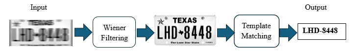

# Projects
Some of the programs that I have personally developed over the past several years for various University related and personal projects

## lidar_insect_detection

### Overview

I worked with a team of 4 on my senior design capstone project to develop Agripollinate. A more detailed description of the project, as well as the code that I personally developed and associated documentation can be found in the /lidar_insect_detection folder.

Agripollinate is a proof of concept project that uses LiDAR sensing, image-based machine learning, and live dashboard visualization to monitor insect activity around plants in real time and display key insights about pollination and pest activity for farmers.

The system detects insects as they interact with flowers, classifies them as pollinators or non-pollinators, and displays results through a live dashboard with heatmap visualization.

### My Role

My primary role in the project was to create a program for a Raspberry Pi that would orchestrate the main dataflow of the project, manage communication between two separate cloud hosted machine learning models using customized TCP-based structured packet communication, and process raw LiDAR data in order to detect the presence of insects in the LiDAR's field of view.

## license_plate_reader

This project’s objective is to read the license plate numbers from images of license plates that have been corrupted by motion blurring. My program does this in two parts. First, image restoration is performed on the motion blurred images using a Wiener filter, and second, a template matching technique is used to “read” the number on the license plate. Again, more detailed documentation can be found in the /license_plate_reader folder.

