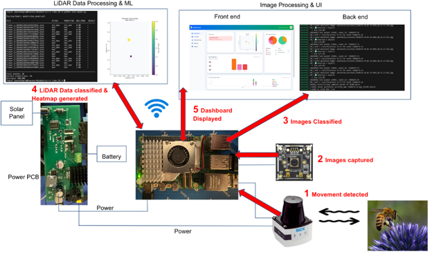
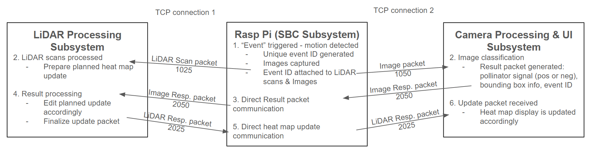

# Pollination Monitoring System (AgriPollinate)

## Overview

I worked with a team of 4 on my senior design capstone project to develop Agripollinate. Here is provided a general overview of the project as a whole, including the contributions of myself and my teamates. This folder includes exclusively the code that I developed in my role in the project which is detailed more specifically below.

Agripollinate is a smart pollination monitoring system designed to help farmers track pollinator activity in real time. Traditional monitoring methods are manual, slow, and not scalable. This system automates the process using LiDAR sensing, image-based machine learning, and live dashboard visualization.

The system detects insects as they interact with flowers, classifies them as pollinators or non-pollinators, and displays results through a live dashboard with heatmap visualization.


---
## System Data flow



## System Architecture

The system is composed of multiple integrated subsystems working together in an end-to-end pipeline from detection to visualization:

| Subsystem | Description |
|-----------|-------------|
| LiDAR Processing & ML | Motion detection, feature extraction, Random Forest classification |
| Image Classification | YOLOv8-based insect detection via FastAPI backend |
| Raspberry Pi Control | Hardware coordination and event pipeline triggering |
| LiDAR Client | LiDAR data streaming and event generation |
| Communication Layer | Structured packet-based messaging between subsystems |
| Web Dashboard | Real-time detection results and heatmap visualization |
| Power / Hardware | Custom PCB designs for solar power management |
| Enclosure | 3D-printed housing structure |

---


## Key Features

- Real-time pollinator detection at the flower level
- LiDAR-based motion analysis with ML classification
- YOLOv8 image-based insect detection
- Random Forest LiDAR model with ~92% cross-validation F1 score
- Sensor fusion between camera and LiDAR subsystems
- TCP-based structured packet communication
- Live heatmap dashboard visualization
- Custom dataset collected from real hardware deployment
- Batch data collection pipeline for model retraining

---

## Hardware

- Raspberry Pi 5
- LiDAR sensor module
- Camera module
- Custom PCB
- Solar power management system
- 3D-printed enclosure housing

---


## Results

- ~92% pollinator classification accuracy on held-out test set
- Reliable real-time detection pipeline with low latency
- Stable sensor fusion logic across LiDAR and camera
- Successful full system integration and deployment testing

---

# Agripollinate Pi Program (This folder)

This folder contains the Raspberry Pi master-side runtime for flower-visit event detection, image capture, and bidirectional packet routing between image and LiDAR clients. Developed by me, Josiah Faircloth

## Program Structure

The system operates as an event-driven, flower-centric pipeline:

1. LiDAR stream is read in real time.
2. Flower occupancy is detected with per-flower thresholds and confirmation windows.
3. Event start triggers image burst capture/transmission.
4. Event end packages visit data for LiDAR data client transmission.
5. Master forwards response packets between image and LiDAR clients using a shared protocol.

## Files

### Core Runtime Modules

- **`master_main.py`**
     - Main orchestrator for all subsystems.
     - Handles startup/shutdown, watchdog checks, testing mode, event callbacks, and cross-server linking.

- **`lidar_parser.py`**
     - Manages TCP connection to the SICK LiDAR scanner.
     - Parses `LMDscandata` telegrams.
     - Supports selective index parsing so only required flower angle indices are decoded for detection.
     - Integrates flower configuration setup, deriving flower angle indices and background distances from baseline scans at startup for a seamless end-to-end workflow.

- **`event_detector.py`**
     - Performs flower visit detection from scan data.
     - Uses configured flower angle indices and background distances.
     - Emits `start` and `end` events with distance history and metadata.

- **`image_capture.py`**
     - Runs image server socket and captures images via `fswebcam`.
     - Sends image data with packet headers (`1050`) and receives image-client responses (`2050`).
     - Forwards responses to the LiDAR data server when connected.

- **`lidar_data_server.py`**
     - Runs LiDAR data server socket for event payload delivery.
     - Sends event packets (`1025`) and handles LiDAR-client responses (`2025`).
     - Forwards responses to the image server when connected.

### Shared Protocol Module

- **`communication_protocol.py`** *(stored in the project root — shared across subsystems)*
     - Defines packet header/payload format, serialization, and parsing.
     - Defines packet IDs used by both server paths (`1025`, `1050`, `2025`, `2050`).
     - Provides shared event ID helpers.



### External Troubleshooting Utility

- **`flower_setup.py`**
     - Standalone utility for manually running and inspecting the flower configuration process outside of the main runtime.
     - Useful for diagnosing sensor placement, verifying baseline scans, and validating flower angle indices and background distances in isolation.
     - Flower configuration logic is fully integrated into `lidar_parser.py` for normal operation; this script is intended for troubleshooting purposes only.

### Data Directories

- **`captured_images/`** — local image output/download area.
- **`lidar_downloads/`** — local LiDAR/event data output/download area.

## Master_Main Data Flow

```text
Master_Main Requires some user input on program statup but is designed to run smoothly with no human interference after the initial setup phase.

1. LiDAR Scanner connection is established
     - If a timeout or connection failure occurs the user will be asked if connection should be skipped
     - Yes -> Program will continue in TESTING mode without a scanner connected. Further connections will proceed as normal
     - No -> retry conncection

2. If Scanner is connected sucessfully, User is asked if auto flower config should be performed
     - Yes -> Flower setup function runs
           -> each detected flower will require confirmation
     - No -> default Flower setup data is used

3. Image Server is launched, client connected
     - listens indefinetely untill a connection is made

4. LiDAR Data Server is launched
     - If a timeout or connection failure occurs the user will be asked if connection should be skipped
     - Yes -> Program will continue with no LiDAR Data Client
     - No -> retry connection

5. Parsing begins
     - If TESTING mode -> Program will simply wait for user input to simulate an event
     - If not TESTING mode -> Program will begin parsing lidar data in real time, events may now be triggered by placeing an object in front of configured flowers

6. Automatic Connection handling
     - At this point, the program can run without user interference. Any disconnections from the Image Client, 
          LiDAR Data Client, or LiDAR Scanner will be handled automatically with smooth reconnect

```


## Running

On Raspberry Pi (master):

```bash
cd pi_program
python3 master_main.py
```

## Dependencies

Python standard library only for core runtime modules.

System dependency for image capture:

- `fswebcam` (example install on Debian/Raspberry Pi OS):

```bash
sudo apt-get install fswebcam
```
